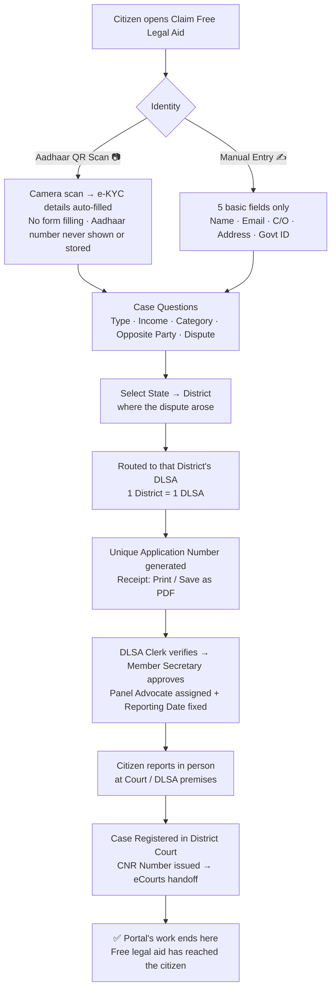
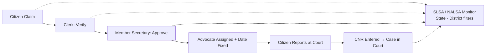

<div align="center">

# ⚖️ Legal Aid India

### District & National Legal Services Authority (DLSA · SLSA · NALSA) — Citizen Services Portal

**Claim Free Legal Aid → Track Your Application → Track Victim Compensation (DBT)**

📞 Toll-Free Legal Aid Helpline: **15100**

[](https://vishwajeetsah.github.io/legal-aid-india/)
[](https://github.com/vishwajeetsah/legal-aid-india)


</div>

---

## 📌 The Problem → The Solution

| # | Problem | What Legal Aid India Does |
|---|---------|---------------------------|
| 1 | Claiming free legal aid means long forms, office visits and middlemen | Citizen scans the **Aadhaar QR code** — details auto-fill, **form filling is bypassed** |
| 2 | After applying, the citizen has no idea where the application stands | A **Unique Application Number** tracks the case through **4 live stages** |
| 3 | Courts grant compensation to victim-survivors, but the money often **never reaches them** | Compensation is tracked like any government **DBT** — sanction → PFMS → **credited to the Aadhaar-seeded bank account** |
| 4 | Courts and authorities cannot see whether their own orders were honoured | **SLSA / NALSA oversight dashboard** with State & District filters and delay alerts |

---

## 📊 Portal at a Glance

| Metric | Value |
|--------|-------|
| Citizen services | **3** (Claim · Track Application · Track DBT) |
| Official roles | **3** (Front Office Clerk · Member Secretary · SLSA/NALSA Monitor) |
| Coverage | **36** States & UTs · all districts (LGD-based) |
| Madhya Pradesh | **55 districts**, each mapped to its own DLSA |
| Application stages | **4** (Received → Verified → Approved → Registered in Court) |
| DBT stages | **4** (Verified → Sanctioned → Sent to Bank (PFMS) → Credited) |
| Application number | **5 segments** with a **Luhn Mod-10 check digit** |
| Oversight alert | Cases pending beyond **7 days** are flagged (SLA) |
| Languages | English + हिन्दी (full interface) |
| Accessibility | A- / A / A+ font size · High Contrast toggle |

---

## 🗺️ How It Works — Citizen Journey



---

## 1️⃣ Claim Free Legal Aid

### Two ways to give your identity

| Path | How | Fields the citizen types |
|------|-----|--------------------------|
| 📷 **Aadhaar QR Scan** (fast path) | Point the phone camera at the QR code printed on the Aadhaar card; verified e-KYC details are fetched and auto-filled | **None** — form filling is bypassed |
| ✍️ **Manual Entry** (fallback) | For citizens without an Aadhaar QR | Full Name · Email · C/O (guardian / care-of) · Permanent Address · Govt ID type + number |

### Then, simple case questions

| Step | Input |
|------|-------|
| Application Type | Legal Aid (LA) / Victim Compensation (VC) |
| Annual Income | Amount (₹) |
| Category | Simple category picker — plain questions, no legal jargon |
| Opposite Party | Name · Phone · Address |
| The Dispute | Brief description |
| Routing | **State → District where the dispute arose** (not the Aadhaar address) |

### 🔢 Anatomy of the Unique Application Number

```
MP09 - LA - 251126 - 0042 - 7
 │      │      │        │     └── Check Digit (Luhn Mod-10 — a typo is caught instantly)
 │      │      │        └──────── Case Counter (serial number)
 │      │      └───────────────── Date of Filing (DDMMYY)
 │      └──────────────────────── Type: LA = Legal Aid · VC = Victim Compensation
 └─────────────────────────────── State + District Code (MP09 = Indore)
```

| Segment | Example | Meaning |
|---------|---------|---------|
| District Code | `MP09` | Indore, Madhya Pradesh (real district codes — Bhopal `MP04`, Sagar `MP15`, Jabalpur `MP20`…) |
| Type | `LA` / `VC` | Legal Aid / Victim Compensation |
| Date | `251126` | Filed on 25 Nov 2026 |
| Counter | `0042` | 42nd application in that series |
| Check Digit | `7` | Luhn Mod-10 validation digit |

---

## 2️⃣ Track Application

Enter the Unique Application Number → see the case move, live:

| Stage | Status | What the citizen sees |
|-------|--------|-----------------------|
| 1 | 📥 Application Received | Routed to the DLSA of the dispute district |
| 2 | ✔️ Verified by DLSA Front Office | Data verified by the Clerk |
| 3 | ⚖️ Approved & Panel Advocate Assigned | **Reporting Slip** — Advocate's name & phone, Court/DLSA premises, reporting date, document checklist |
| 4 | 🏛️ Case Registered in District Court | **CNR Number** + handoff to the District Courts / eCourts portal |

> **Rule built into the system:** the CNR Number is generated **only after the applicant physically reports** at the court premises — never before. On approval, the citizen gets only the reporting slip. After registration, the case belongs to the court and **the portal's purpose is fulfilled**.

🔗 eCourts: https://services.ecourts.gov.in/ecourtindia_v6/

---

## 3️⃣ Track DBT / Victim Compensation

> Courts grant compensation to victim-survivors — but too often the amount **never reaches the victim**. Farmers get money by DBT. Pensioners get money by DBT. **Why not the victim?**

| Stage | Status |
|-------|--------|
| 1 | ✔️ Application Verified |
| 2 | 📜 Sanctioned by DLSA |
| 3 | 🏦 Sent to Bank (PFMS) |
| 4 | 💰 **Credited to Bank Account** — the survivor's **Aadhaar-seeded** account, so no middleman can divert it |

This gives **courts an eye on their own orders** — they can see whether the compensation they granted actually reached the person it was granted for.

---

## 🏢 DLSA Official Login — One Box, Three Roles

The official's district is auto-scoped from their official ID (e.g. `clerk.mp09@nic.in` → Indore DLSA).

| Role | Sees | Powers |
|------|------|--------|
| **Front Office Clerk** | Only own district's applications | ✅ Verify citizen data · 🔁 Transfer jurisdiction to any State/District (application number stays the same) |
| **Member Secretary** | District applications | ✅ Approve / Reject · 👨‍⚖️ Assign Panel Advocate · 📅 Fix the court reporting date · After reporting: enter CNR |
| **SLSA / NALSA Monitor** | **All-India, read-only** | 📊 Oversight dashboard · **Filters by State and District** · Status counts · ⏰ 7-day SLA delay alerts |

Every official action reflects **immediately** in the citizen's tracking views — one shared record.



---

## 🎬 Try the Demo — Sample Data Built In

Tap any sample number inside the Track tabs, or type it:

| Application Number | District | Applicant | Type | Position |
|--------------------|----------|-----------|------|----------|
| `MP09-LA-141126-0003-6` | Indore | Sunita Verma | Legal Aid | Stage 1 — Received (pending) |
| `MP15-VC-161126-0007-7` | Sagar | Kamla Bai | Victim Compensation | Approved · DBT Stage 3 — Sent to Bank (PFMS) |
| `MP04-LA-101126-0012-6` | Bhopal | Mohd. Salim | Legal Aid | Stage 4 — Registered · CNR `MPBH010045612025` |
| `MP20-VC-181126-0005-7` | Jabalpur | Rani Devi | Victim Compensation | ✅ DBT Complete — Credited to Aadhaar-seeded account |

### Demo official logins (any password works in the prototype)

| Login ID | Role | Lands on |
|----------|------|----------|
| `clerk.mp09@nic.in` | Front Office Clerk, Indore | Indore district queue |
| `sec.mp15@nic.in` | Member Secretary, Sagar | Sagar approvals |
| `monitor@nic.in` | SLSA / NALSA Monitor | All-India oversight dashboard |

**Live-sync demo:** log in as the Indore Clerk and verify Sunita Verma's application (`MP09-LA-141126-0003-6`) — then track it as a citizen and watch it move to Stage 2 instantly.

---

## 🎨 Design System

Strict Government of India / judiciary-portal conventions (GIGW-style) — no startup UI, no gradients, no clutter.

| Element | Specification |
|---------|---------------|
| Background | White `#FFFFFF` |
| Primary (Navy) | `#1B365D` |
| Accent (Gold hairline) | `#C87D28` |
| Text | `#1A202C` |
| Header | National Emblem (left) · Portal title · NALSA logo (right) — both logos link to this portal's Home |
| Utility Bar | भारत सरकार \| Government of India · A- / A / A+ · High Contrast toggle · English / हिन्दी |
| Mobile | Menu bar is desktop-only · Both logos on **one line** · Single ☰ menu · Home = 3 service tiles only |
| Desktop | Full menu bar — because DLSA officers work on computers; citizens work on phones |

---

## ⚙️ Technical Notes

| Item | Detail |
|------|--------|
| Build | Single static page (`index.html`) — no build step, no server |
| Camera | Device camera (`getUserMedia`) + jsQR decoding, in-browser |
| Data | LGD-based States / Districts dataset embedded in the page |
| Persistence | Browser localStorage — citizen and officer views share one record |
| Hosting | GitHub Pages (any static HTTPS host works) |
| Camera requirement | Must run as a **top-level HTTPS page** — browsers block cameras inside frames and on `file://` |

### 🔐 Production notes (honest by design)

- The Aadhaar QR scan runs in **demo mode** in this prototype. In production, Aadhaar authentication runs **only through UIDAI-approved tooling** — the real Aadhaar Secure QR is encrypted and readable only by official applications.
- In production, the portal connects to the DLSA/SLSA/NALSA back office, **PFMS** for DBT status, and **eCourts** for the CNR handoff.
- The Aadhaar number is **never displayed and never stored** — in the prototype or in the production design.

---

## 🚀 Run It

1. **Live:** https://vishwajeetsah.github.io/legal-aid-india/
2. **Locally:** download `index.html` and serve this folder with any static server, e.g.
   ```bash
   npx serve .
   ```
   Then open the `https` / `localhost` address — the camera scan needs a secure context.

---

<div align="center">

**Designed & Developed by Vishwajeet Sah**
B.A. LL.B. (Hons), Dr. Harisingh Gour Vishwavidyalaya, Sagar · Para Legal Volunteer, DLSA Sagar

*Access to Justice for All — न्याय सब के लिए*

</div>
